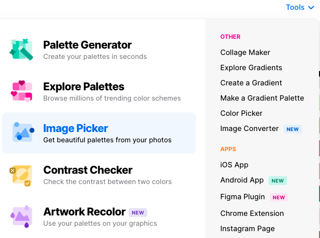
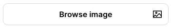
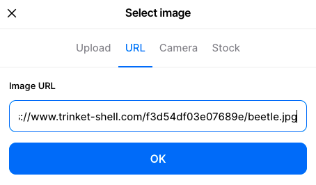
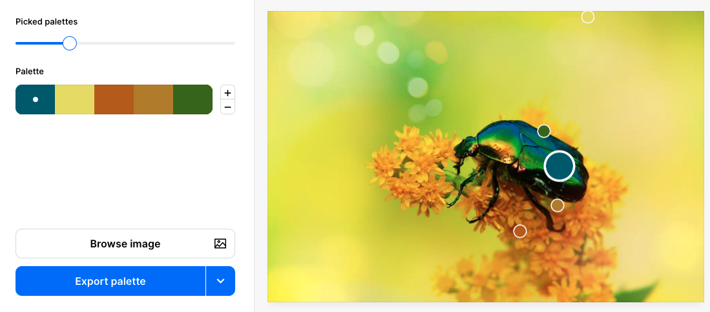
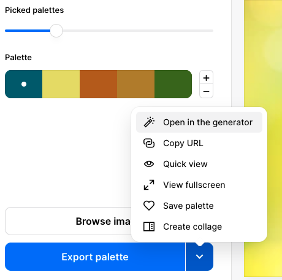
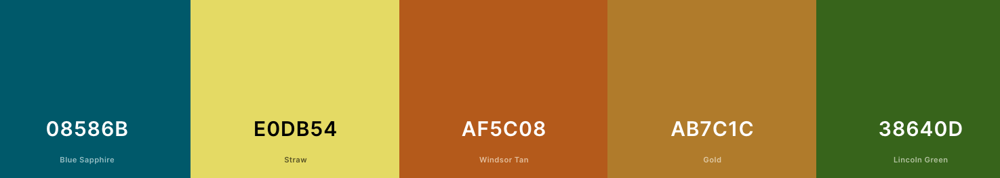

Натисни правою кнопку миші на зображення на вебсторінці та вибери «Копіювати адресу зображення» або «Копіювати посилання на зображення»:

У новій вкладці браузера перейди на сторінку [coolors.co](https://coolors.co){:target="_blank"}. Вибери меню «Інструменти», тоді «Вибір зображень».

Натисни кнопку «Переглянути зображення».

Натисни на «URL-адресу», тоді встав скопійовану адресу зображення в поле «URL-адреса зображення». Натисни «ОК».

Зразки палітри створюються з твого зображення. Ти можеш скористатися повзунком «Вибрані палітри», щоб вибрати потрібну колірну схему.

Коли тебе влаштовує палітра, натисни на стрілку спадного меню «Експортувати палітру» та вибери «Відкрити в генераторі».

Показано кінцеву палітру. Літери та цифри — це шістнадцяткові коди для обраних кольорів. Онови значення змінних у файлі `default.css`, щоб використовувати ці нові кольори.

## --- code ---

language: html
filename: default.css
line_numbers: true
line_number_start: 4
line_highlights: 5-14
----------------------------------------------------------

:root {
\--primary: #08586B;
\--onprimary:#4f4e4e;
\--secondary: #E0DB54;
\--onsecondary:#ffffff;
\--tertiary:#AF5C08;
\--ontertiary: #ffffff;
\--page:#ffffff;
\--onpage:#000000;
\--detail: #AB7C1C;
\--detail2: #38640D;
}

\--- /code ---
